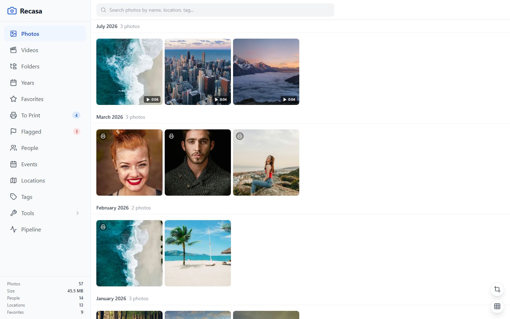
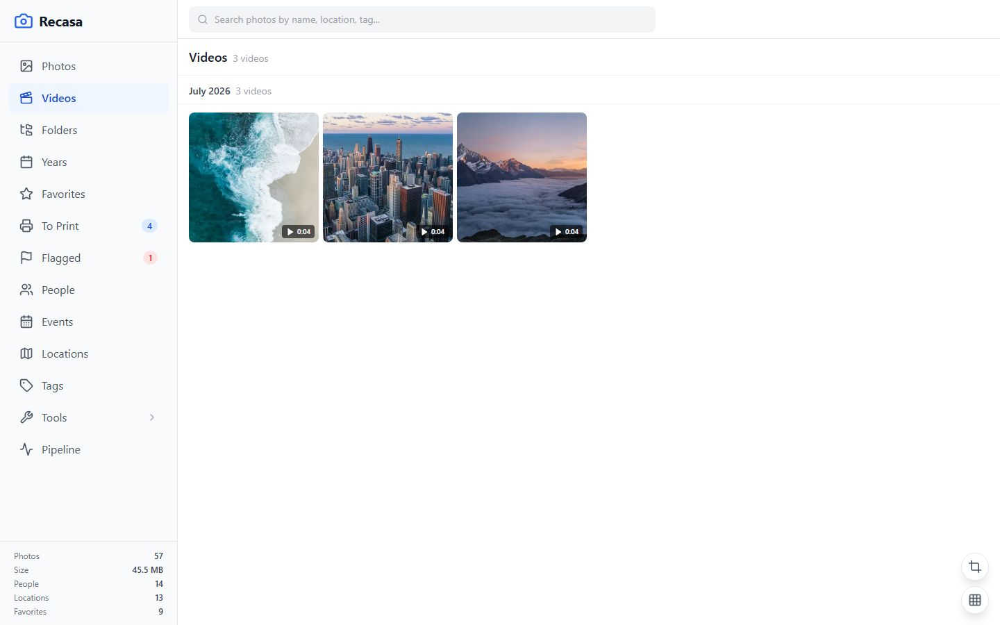
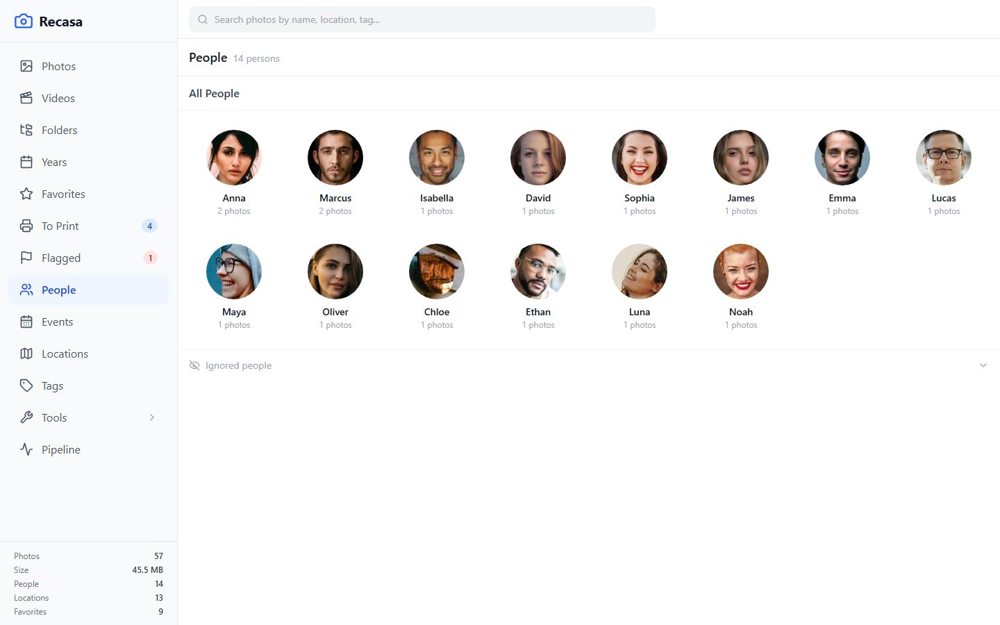
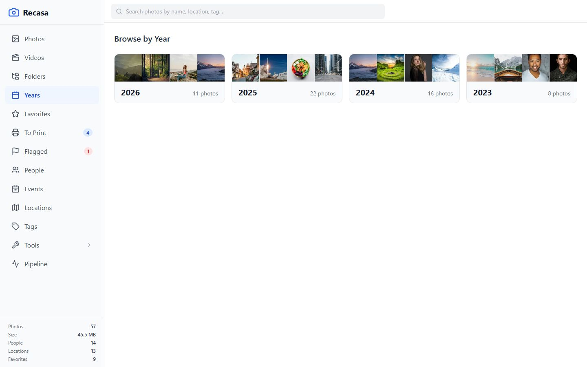
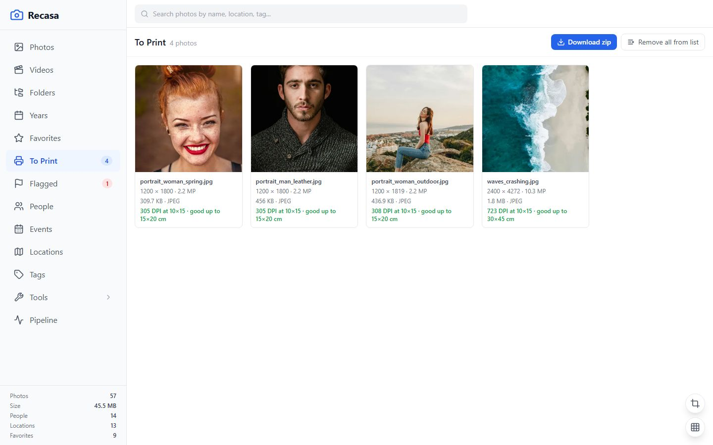
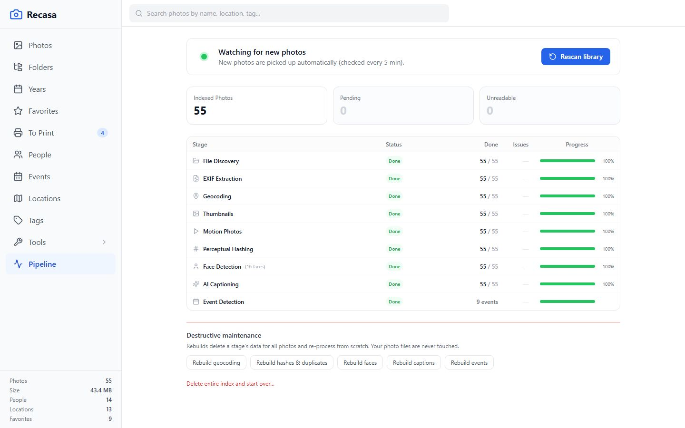
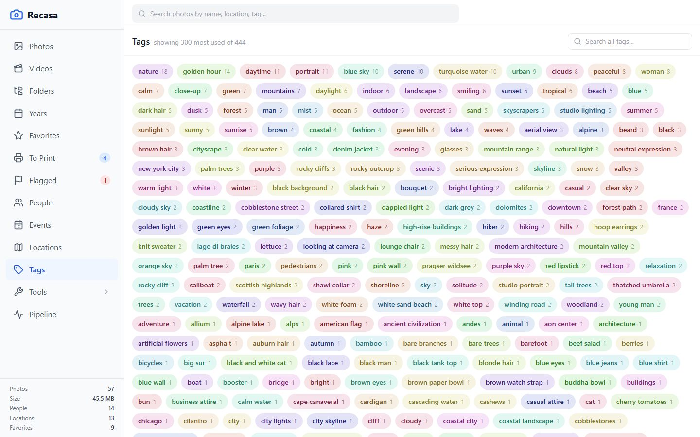
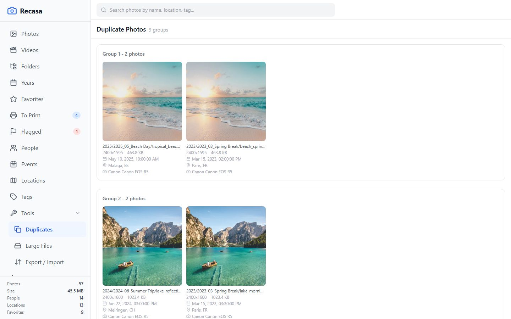
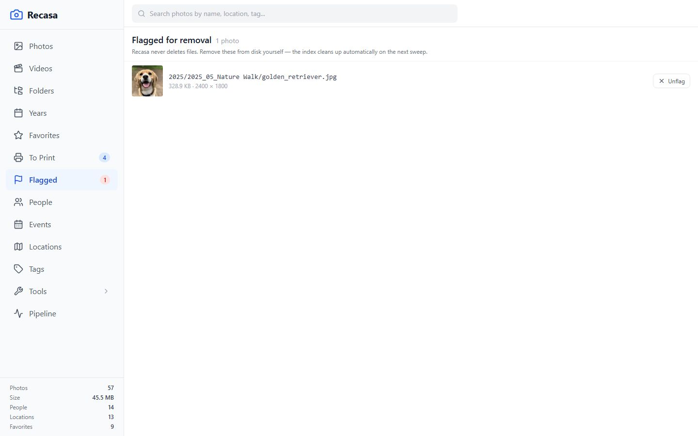
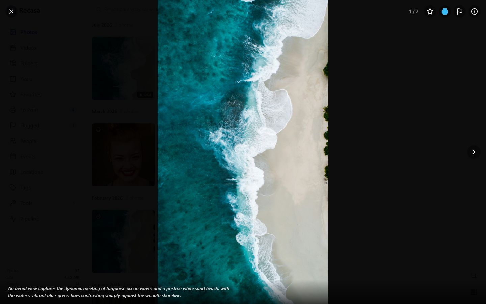

# Recasa

**A self-hosted photo & video manager that runs entirely on your own machine.**
Browse your library by time, people, places, events, and tags — with face
detection, duplicate finding, and AI tagging all processed locally. Nothing is
ever uploaded; your photos are mounted read-only into the container.



---

## Highlights

### Timeline for photos and videos

Everything lands on one scrollable timeline, grouped by month. Videos are
indexed alongside photos with a poster frame and duration, and get their own
section too.



### People

Faces are detected and clustered into people you can name. Recasa finds who
appears together and lets you ignore clusters you don't care about.



### Browse by year

Each year is a card with a strip of preview photos sampled across the year, so
you can jump straight to the era you're looking for.



### To Print

Collect photos for printing the way you favorite them, review print quality
(resolution and effective DPI at common sizes) per photo, then download a
print-ready zip — HEIC converted to JPEG — to upload to any print service.



### Processing pipeline, honestly reported

A single dashboard shows whether the library is being watched or processed,
what's pending, and which files are genuinely unreadable — listed with reasons
instead of being retried forever.



### AI tags &nbsp;·&nbsp; Duplicates &nbsp;·&nbsp; Flag for removal

| | |
|---|---|
|  |  |
| *AI tags (top tags + search across all)* | *Duplicate detection* |
|  |  |
| *Flag for removal (recasa never deletes)* | *Full-screen viewer* |

---

## Installation

Requires [Docker](https://docs.docker.com/get-docker/).

```bash
git clone https://github.com/yonie/recasa.git
cd recasa
cp .env.example .env
```

Edit `.env` and set `PHOTOS_PATH` to your photo directory:

```
PHOTOS_PATH=/path/to/your/photos
```

Then start the container:

```bash
docker compose up -d
```

Open http://localhost:8080. Recasa scans your library and indexes it in the
background; progress is shown on the Pipeline page. New, changed, and removed
files are picked up automatically thereafter — including on Docker Desktop,
where filesystem events don't reach the container.

## All features

- **Timeline** — photos and videos grouped by month and year
- **Videos** — standalone videos indexed with poster frames and duration, on
  their own page and inline in every view (Apple Live Photo movies are detected
  and kept attached to their photo, not listed separately)
- **People** — face detection and clustering into renameable persons, plus
  "appears together" groups
- **Events** — automatic grouping by time and location
- **Map** — geotagged photos on OpenStreetMap, with a Hero Trail mode that
  replays your route chronologically
- **Search** — file names, locations, tags, captions, people, and dates
  (e.g. "2013 august")
- **Tags** — AI-generated scene/object tags (requires Ollama)
- **Captions** — natural-language descriptions per photo (requires Ollama)
- **Duplicates** — perceptual-hash grouping (pHash/aHash/dHash), flag a copy
  right from the group
- **Favorites** — star photos from the grid or viewer
- **To Print** — collect, quality-check, and export a print-ready zip
- **Flag for removal** — mark photos to delete yourself; they're hidden from all
  views and listed with their paths (recasa never deletes your files)
- **Folders** — browse by original directory structure
- **Years** — year cards with preview photos
- **Live Photos** — hover-to-play for Apple Live Photos and Google Motion Photos
- **EXIF** — camera, lens, exposure, GPS metadata
- **Reverse geocoding** — GPS to city/country names, offline, no API keys
- **Grid views** — three thumbnail sizes; cropped squares or full photos
- **Collages** — generate a shareable collage from any view

## Configuration

All settings go in `.env`:

| Variable | Default | Description |
|----------|---------|-------------|
| `PHOTOS_PATH` | *(required)* | Path to your photo directory on the host |
| `RECASA_PORT` | `8080` | Port for the web UI |
| `OLLAMA_URL` | `http://ollama:11434` | URL for the Ollama API (optional) |
| `WATCH_INTERVAL` | `300` | How often to check for new files (seconds, `0` disables) |
| `LOG_LEVEL` | `info` | Logging level (`debug`, `info`, `warning`, `error`) |

### Processing stages

Each stage can be toggled independently. Already-processed photos are skipped on rescan.

| Variable | Default | Effect |
|----------|---------|--------|
| `ENABLE_EXIF_EXTRACTION` | `true` | Read camera metadata, GPS, and dates from photos |
| `ENABLE_GEOCODING` | `true` | Convert GPS coordinates to city/country names (offline) |
| `ENABLE_THUMBNAILS` | `true` | Generate WebP thumbnails at 200/600/1200px |
| `ENABLE_MOTION_PHOTOS` | `true` | Extract video from Live Photos and Motion Photos |
| `ENABLE_HASHING` | `true` | Perceptual hashing for duplicate detection |
| `ENABLE_FACE_DETECTION` | `true` | Detect faces and cluster them into people |
| `ENABLE_CAPTIONING` | `false` | Generate AI captions and tags (requires Ollama) |

### Ollama (optional)

Tags and captions require [Ollama](https://ollama.com) with a vision model.
Without it, all other features work normally.

```bash
docker run -d --name ollama -p 11434:11434 ollama/ollama
docker exec ollama ollama pull qwen3-vl:30b-a3b-instruct
```

Add to your `.env`:

```
OLLAMA_URL=http://host.docker.internal:11434
ENABLE_CAPTIONING=true
```

## Supported formats

**Photos:** JPEG, PNG, WebP, HEIC/HEIF, TIFF, BMP

**Videos:** MP4, MOV, AVI, MKV (poster + metadata always work; in-browser
playback depends on the codec — modern H.264/H.265 play directly, older
formats offer a download link)

**Live Photos:** Apple (HEIC+MOV paired), Google Motion Photos (embedded MP4)

## License

MIT
